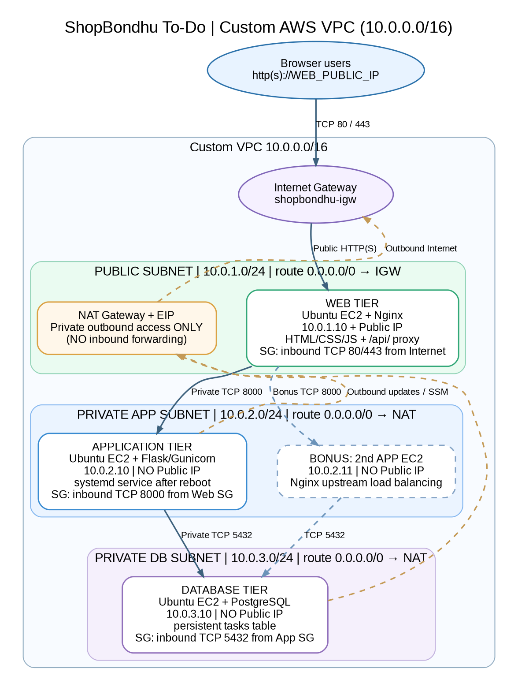

# ShopBondhu To-Do Manager — 3-Tier AWS VPC (Nginx Only)

A simple, working **three-tier To-Do application** for an AWS networking assignment. Built from scratch on a **custom Amazon VPC** with **EC2, Nginx, Flask/Gunicorn, and PostgreSQL**. Nginx is the **only public HTTP(S) entry point**. No ALB, NLB, RDS, Beanstalk, ECS, or EKS are used.

**START HERE: [Complete numbered AWS deployment guide](docs/DEPLOYMENT_GUIDE.md)**. Follow its steps before attempting to install individual services.



## Features

- Add, view, complete, and delete tasks in a browser.
- Tasks are stored persistently in PostgreSQL on a **private** database EC2 instance.
- API on a separate **private** Flask/Gunicorn EC2 instance.
- Nginx on **public** EC2 serves HTML/CSS/JavaScript and reverse-proxies `/api/` to app EC2.
- App starts automatically after reboot using `systemd`.
- `scripts/install-db.sh`, `scripts/install-app.sh` and `scripts/install-web.sh` automate installation (bonus).
- Optional **two-app Nginx upstream** and **Certbot HTTPS** are described in the guide.

## Architecture and access rules

| Tier | Subnet | EC2 private IP | Public IP | Technology | Inbound access |
|---|---|---|---|---|---|
| Web | `10.0.1.0/24` | `10.0.1.10` | Yes | Nginx | TCP 80/443, internet |
| Application | `10.0.2.0/24` | `10.0.2.10` | **No** | Flask + Gunicorn + systemd | TCP 8000, **web SG only** |
| Database | `10.0.3.0/24` | `10.0.3.10` | **No** | PostgreSQL | TCP 5432, **app SG only** |

`10.0.0.0/16` is the VPC CIDR. The web subnet uses an Internet Gateway; private subnets use a NAT Gateway **for outbound traffic**. The NAT EIP is on a NAT resource, not on an app/DB EC2 instance. Admin access uses AWS Session Manager instead of inbound SSH.

## Project files

```text
shopbondhu-3tier-aws/
├── backend/
│   ├── app.py                 # REST API: GET/POST/PATCH/DELETE tasks
│   ├── requirements.txt
│   └── .env.example           # Safe placeholder only
├── frontend/
│   ├── index.html             # Browser UI
│   ├── styles.css
│   └── app.js
├── database/
│   └── schema.sql             # PostgreSQL persistent table
├── nginx/
│   ├── shopbondhu.conf        # One-app proxy
│   └── shopbondhu-bonus-two-apps.conf
├── scripts/
│   ├── install-db.sh
│   ├── install-app.sh
│   ├── install-web.sh
│   └── shopbondhu-api.service # Reboot-surviving service
├── docs/
│   ├── architecture.png
│   ├── architecture.svg
│   ├── architecture.mmd
│   ├── DEPLOYMENT_GUIDE.md    # FULL from-scratch AWS console guide
│   ├── PROBLEMS_AND_FIXES.md # Adapt to actual experience
│   └── SUBMISSION_CHECKLIST.md
├── screenshots/
│   └── README.md             # Add ACTUAL AWS/browser captures here
├── tests/
│   └── test_validation.py
├── .gitignore
└── README.md
```

## API endpoints

| Method | URL | Description | Example body |
|---|---|---|---|
| GET | `/api/health` | Checks database connection | — |
| GET | `/api/tasks` | Lists latest 100 saved tasks | — |
| POST | `/api/tasks` | Adds a task to PostgreSQL | `{"title":"Finish assignment"}` |
| PATCH | `/api/tasks/1` | Updates completion state | `{"completed":true}` |
| DELETE | `/api/tasks/1` | Deletes a task | — |

Browser UI and API share one public origin, so the browser needs **no CORS exemption**. Backend uses parameterized SQL queries and validates input; frontend adds task titles via `textContent`, not raw HTML.

## Install order (AWS EC2 Session Manager)

**First** complete networking, IAM role, and GitHub setup as in the [detailed guide](docs/DEPLOYMENT_GUIDE.md).

On each EC2, use **EC2 -> Connect -> Session Manager**, then `sudo -i`. Clone the **public** GitHub repository; replace `YOUR_GITHUB_USERNAME`:

```bash
apt-get update && apt-get install -y git
git clone https://github.com/YOUR_GITHUB_USERNAME/shopbondhu-3tier-aws.git /tmp/shopbondhu-3tier-aws
cd /tmp/shopbondhu-3tier-aws
```

- **DB EC2 first:** `bash scripts/install-db.sh` (enter strong PostgreSQL password)
- **App EC2 second:** `bash scripts/install-app.sh` (enter the SAME password)
- **Web EC2 last:** `bash scripts/install-web.sh`
- **Optional bonus web after app2 installed:** `bash scripts/install-web.sh --two-apps`

Visit `http://WEB_PUBLIC_IP/`, add two tasks, refresh, and observe persistence. Verify `http://WEB_PUBLIC_IP/api/health` returns a connected database status.

## Verify backend survives reboot

```bash
systemctl is-enabled shopbondhu-api
systemctl is-active shopbondhu-api
sudo reboot
# Reconnect via Session Manager after the machine starts
systemctl is-active shopbondhu-api
```

## Tests for API input validation (optional local)

```bash
python3 -m venv .venv
. .venv/bin/activate
pip install -r backend/requirements.txt
python -m unittest discover -s tests -v
```

On Windows PowerShell, activate with `.\.venv\Scripts\Activate.ps1` (depending on execution policy) or run `.\.venv\Scripts\python.exe -m unittest discover -s tests -v` directly. These tests check **invalid input handling only**; a successful full three-tier test requires deployed PostgreSQL and the actual AWS browser test.

## Evidence / GitHub submission

Add genuine screenshots in `screenshots/` matching `screenshots/README.md`, then commit and push. The architecture diagram is in `docs/architecture.png` and `docs/architecture.svg`. The [submission checklist](docs/SUBMISSION_CHECKLIST.md) contains every required proof item. Record actual issues in [Problems and Fixes](docs/PROBLEMS_AND_FIXES.md); do not submit examples as if they happened.

## Cost warning

A NAT Gateway incurs hourly and processed-data charges, and public IPv4 addresses can be billed. **After evidence is captured, stop all EC2 instances, delete the NAT Gateway, release the NAT Elastic IP, and clean up unused public IPv4 addresses.** Stopped instances can still incur **EBS storage** charges. Refer to [Part I: cleanup](docs/DEPLOYMENT_GUIDE.md).

## References

- [AWS VPC creation](https://docs.aws.amazon.com/vpc/latest/userguide/create-vpc.html)
- [AWS EC2 Session Manager](https://docs.aws.amazon.com/AWSEC2/latest/UserGuide/connect-with-systems-manager-session-manager.html)
- [AWS Session Manager instance profile](https://docs.aws.amazon.com/systems-manager/latest/userguide/session-manager-getting-started-instance-profile.html)
- [AWS VPC pricing](https://aws.amazon.com/vpc/pricing/)

**Coursework scope:** one AZ, one NAT Gateway, and one database EC2 are selected to keep the architecture simple and inspectable, not as a claim of high availability. For real production, use backups, patch management, managed secrets, monitoring, redundant AZs, and a properly designed high-availability database.
